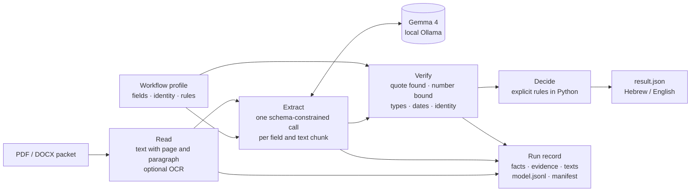

<div align="center">

# Medical Approval

**Evidence-grounded review of medical prior-authorization packets with a local LLM.**

The model reads the documents. The code makes the decision. Every fact behind it is a quote that was found in the source.

[](https://github.com/Doringber/harelai/actions/workflows/tests.yml)


[Quick start](#quick-start) · [How it works](#how-it-works) · [Results](#results-for-the-supplied-case) · [Profiles](#workflow-profiles) · [Limitations](#limitations) · [תשובה למטלה (עברית)](ai/submission.md)

</div>

---

A request for a robotic-assisted transbronchial lung biopsy arrives with five PDFs: the authorization form, the clinical note, the CT report, the laboratory results and the pulmonary function tests. This project reads all five and extracts the request details and the clinical findings. It checks every extracted value against the source text and returns `APPROVE` or `MANUAL_REVIEW`, with a reason in Hebrew or English.

- **The model never decides.** Gemma 4 runs locally through Ollama and only extracts fields. The four approval rules are explicit conditions evaluated in Python.
- **No quote, no fact.** Each value must arrive with a quote that is found in the document. Numbers must belong to their own measurement: a DLCO value cannot pass as FEV1, and a threshold such as “FEV1 >60%” is not treated as a result.
- **Fails closed.** Missing documents or fields, a patient-identity mismatch, conflicting evidence, a contraindication or a failed model call all lead to `MANUAL_REVIEW`. There is no automatic rejection path.
- **Everything is on record.** Each run writes the result, the verified facts with page references, the extracted text, the raw model responses and a manifest with file hashes.
- **Data stays local.** Documents never leave the machine. Cloud model tags are refused.

## Quick start

Requirements: [Python 3.11+](https://www.python.org/downloads/), [Ollama](https://ollama.com/download) (running), and Git.

```bash
git clone https://github.com/Doringber/harelai.git && cd harelai
ollama pull gemma4

python3 -m venv .venv && source .venv/bin/activate
python -m pip install -e .

python -m approval case.json --language he --output-dir runs/medical
```

The run prints progress for each document, then the decision:

```text
בודק את case.json באמצעות gemma4
  בקשת האישור: הושלם
  הסיכום הרפואי: הושלם
  דו״ח ה־CT: הושלם
  בדיקות המעבדה: הושלם
  בדיקות תפקודי הריאה: הושלם

APPROVE: הממצאים הקליניים תומכים בדגימת רקמה מנודול חשוד ...
```

Use `--language en` for English. Each run needs a new or empty `--output-dir`; existing evidence is never overwritten. A medical packet takes two to three minutes on a laptop.

<details>
<summary><b>Windows (PowerShell)</b></summary>

```powershell
git clone https://github.com/Doringber/harelai.git; cd harelai
ollama pull gemma4
py -3.11 -m venv .venv
.\.venv\Scripts\python.exe -m pip install -e .
.\.venv\Scripts\python.exe -m approval case.json --language he --output-dir runs\medical
(Get-Content -Raw -Encoding UTF8 runs\medical\result.json | ConvertFrom-Json).recommendation
```

The recorded verification ran on macOS.
</details>

## Results for the supplied case

The complete output from local Gemma 4 is committed in [`ai/results/supplied/`](ai/results/supplied), in Hebrew and English. The summary section of the English run:

```json
{
  "case_id": "PA-2025-847291",
  "patient": {
    "name": "Margaret A. Johnson",
    "date_of_birth": "1952-03-15",
    "mrn": "847291"
  },
  "request": {
    "procedure": "Robotic-Assisted Transbronchial Lung Biopsy",
    "cpt_codes": [
      "31629",
      "31632",
      "77012"
    ],
    "requested_date": "2025-12-10"
  },
  "clinical_summary": {
    "finding": "18 x 15 mm part-solid nodule in the right upper lobe, posterior segment",
    "nodule_size": "18 x 15 mm",
    "lung_rads": "4B",
    "suv_max": 4.2,
    "fev1_percent": 62,
    "dlco_percent": 58,
    "coagulation_status": "Normal"
  },
  "recommendation": {
    "status": "APPROVE",
    "reason": "The clinical findings support tissue sampling of a suspicious nodule in the right upper lobe, posterior segment (18 x 15 mm, Lung-RADS 4B). The requested procedure is appropriate for the lesion location and the patient's documented pulmonary condition (FEV1 62% predicted, DLCO 58% predicted), and the laboratory and pulmonary tests show no clear barrier."
  }
}
```

The full `result.json` also contains each rule with its evidence, every issue, and every verified fact with its quote and page. The [fictional alternate case](ai/alternate_case) shows a 6 mm nodule that is stable for 24 months under surveillance. It returns `MANUAL_REVIEW` because neither suspicion nor tissue sampling is supported ([output](ai/results/alternate)).

## How it works



1. **Read** ([`approval/read.py`](approval/read.py)). Text is read page by page from PDFs and paragraph by paragraph from DOCX files, and each document is hashed. A page with a scanned image fails explicitly unless OCR is enabled, so no content is silently skipped.
2. **Extract** ([`approval/extract.py`](approval/extract.py)). Each field in the profile is asked for separately, using a JSON schema with temperature 0 and a fixed seed. Long documents are split into overlapping chunks. Every candidate value is kept, including contradictions.
3. **Verify** ([`approval/workflow.py`](approval/workflow.py), [`approval/check.py`](approval/check.py)). The quote must occur in the document, even across a line break, and condition flags must quote their subject. A number must be the value next to its own label. Dates are normalized, and name, date of birth and MRN must match across documents.
4. **Decide**. Python evaluates the profile rules. Every rule needs at least one verified value, and every value must satisfy the rule. A blocking issue prevents approval.

### Decision rules (lung biopsy profile)

| Rule | Verified evidence required from |
|---|---|
| A suspicious nodule requires investigation | CT report or clinical note |
| Tissue sampling is recommended | CT report or clinical note |
| The requested procedure fits the findings and the patient | Request form or clinical note |
| Preliminary tests show no clear barrier | Laboratory report **and** pulmonary function tests |

`APPROVE` also requires all five documents, matching identity on every document, an MRN on every clinical document, and the requested procedure, CPT codes and service date. No documented contraindication is allowed. Anything else returns `MANUAL_REVIEW`, with a reason that lists each unmet rule and blocking issue.

## Usage

```text
python -m approval CASE.json [--language he|en] [--output-dir DIR] [--model gemma4]
                             [--profile NAME|PATH] [--repeat N] [--chunk-size BYTES]
                             [--ocr --tessdata DIR --ocr-language eng+heb] [--output FILE]
```

| Option | Default | Purpose |
|---|---|---|
| `--language` | `he` | Language of the reason, rule labels and issues. Quotes and values stay verbatim. |
| `--output-dir` | none | Empty folder for the result and the complete run record |
| `--output` | `result.json` | Write only the result file (used when `--output-dir` is not given) |
| `--model` | `gemma4` | Any local Ollama model; `:cloud` tags are refused |
| `--profile` | from the case | Built-in profile name or a JSON path |
| `--repeat` | `1` | Run N times and write `comparison.json` |
| `--chunk-size` | `6000` | UTF-8 byte budget for each model input (32–8000) |
| `--ocr` | off | OCR for scanned PDF pages, using local Tesseract data |

**Exit codes:** `0` means the review completed, whether the result is `APPROVE` or `MANUAL_REVIEW`. `1` means a configuration error, an unreadable document or a failed model call; a partial result is still written. `2` means repeated runs disagreed.

### A case file

```json
{
  "profile": "lung_biopsy",
  "documents": [
    {"id": "request-1",  "role": "request",  "path": "request.pdf"},
    {"id": "clinical-1", "role": "clinical", "path": "notes.docx"},
    {"id": "ct-1",       "role": "ct",       "path": "ct-report.pdf"},
    {"id": "labs-1",     "role": "labs",     "path": "labs.pdf"},
    {"id": "pft-1",      "role": "pft",      "path": "pulmonary-function.pdf"}
  ]
}
```

Paths are relative to the case file. A role can appear more than once, and the evidence from every copy is kept. Unknown roles and duplicate IDs are rejected before anything is processed.

### The run record

| File | Contents |
|---|---|
| `result.json` | Decision, reason, rules with evidence, issues, summary, all verified facts |
| `facts.json` · `evidence.json` | Verified values with quotes, document IDs and page or paragraph locations |
| `texts.json` | The exact text that was read, including OCR text |
| `model.jsonl` | Every raw structured model response, with timings and errors |
| `events.jsonl` | Processing stages and failures |
| `manifest.json` · `profile.json` · `case.json` | Input and profile hashes, model digest, settings and the exact configuration |

## Workflow profiles

A profile is a validated JSON file that defines the fields, the document roles, the identity checks, the blockers, the rules and the summary. Profiles describe conditions; they never execute code. Two profiles are built in:

| Profile | Documents | Decision |
|---|---|---|
| [`lung_biopsy`](approval/profiles/lung_biopsy.json) | request, clinical, CT, labs, PFT | The four rules above |
| [`invoice_payment`](approval/profiles/invoice_payment.json) | English invoice PDF, Hebrew receipt DOCX | Matching invoice number, amount ≤ USD 1,000, goods received |

The invoice profile shows that the same engine handles a different task without code changes. [`examples/invoice/custom_profile.json`](examples/invoice/custom_profile.json) lowers the limit to USD 500 by editing only JSON.

<details>
<summary><b>Profile reference</b></summary>

| Key | Purpose |
|---|---|
| `fields` | Type (`text`, `number`, `flag`, `text_list`), extraction definition, English and Hebrew labels, optional `format` (`date`, `percent`) and `quote_terms` |
| `roles` | Fields to extract from each role, whether the role is required, and its required fields |
| `identity` | Fields that must agree across documents, compared as `text`, `name` or `date` |
| `rules` | Conditions using `eq`, `gte`, `lte` or `contains`; every condition must pass |
| `blockers` | Conditions that prevent approval when any verified value matches |
| `output_fields` | Summary paths; `select: "first"` shows the earliest verified value, with a warning when the values differ; `display: "name"` formats names |
| `approval_reason` | Optional template for the reason. Its `{placeholders}` are filled only from verified summary values; if one is missing, the generic reason is used |

</details>

## Examples and verification

| Scenario | Command | Expected |
|---|---|---|
| Supplied medical packet | `python -m approval case.json --output-dir runs/medical` | `APPROVE` |
| Fictional Hebrew DOCX packet | `python -m approval examples/hebrew_medical/case.json --output-dir runs/he` | `APPROVE` |
| Stable nodule under surveillance | `python -m approval ai/alternate_case/case.json --output-dir runs/alt` | `MANUAL_REVIEW` |
| Invoice: normal, long | `examples/invoice/case.json`, `long_case.json` | `APPROVE` |
| Invoice: over limit, goods missing, conflicting receipts, custom limit | `over_limit_case.json`, `missing_goods_case.json`, `conflict_case.json`, `custom_case.json` | `MANUAL_REVIEW` |
| Scanned invoice (OCR) | `examples/invoice/scanned_case.json --ocr --tessdata .ocr-data` | `APPROVE` |

**Unit and integration tests.** These run the real readers, verification, rules and run record, and replace only the Ollama call. They need no model and run in CI:

```bash
python -m pip install -e ".[dev]"
python -m pytest -q
```

**Live verification.** This runs every scenario above against the real local model, in both languages. It checks the status, the key facts and the required summary values, and confirms that Hebrew and English agree:

```bash
python -u scripts/verify_live.py --model gemma4 --tessdata .ocr-data --output-dir runs/live-check
```

<details>
<summary><b>OCR setup (scanned PDFs, English and Hebrew)</b></summary>

```bash
mkdir -p .ocr-data
curl -fL https://raw.githubusercontent.com/tesseract-ocr/tessdata_fast/main/eng.traineddata -o .ocr-data/eng.traineddata
curl -fL https://raw.githubusercontent.com/tesseract-ocr/tessdata_fast/main/heb.traineddata -o .ocr-data/heb.traineddata
python -m approval examples/invoice/scanned_case.json --ocr --tessdata .ocr-data --output-dir runs/scanned
```

With the tested PyMuPDF wheel, the language data files are sufficient. Pages that mix text and scanned images are handled, and OCR evidence is marked `"ocr": true`.
</details>

## Project layout

```text
approval/
  __main__.py        command line
  workflow.py        case loading, verification, decision, run record
  read.py            PDF and DOCX reading, OCR, chunking
  extract.py         schema-constrained extraction through Ollama
  check.py           normalization and evidence checks
  profiles/          profile schema and the built-in lung_biopsy and invoice_payment profiles
ai/
  01–05_*.pdf        the supplied packet
  alternate_case/    a fictional second medical case and its sources
  results/           committed outputs for both medical cases
  submission.md      assignment answer (Hebrew)
examples/            fictional Hebrew medical packet and invoice scenarios
scripts/verify_live.py   live-model verification
tests/               pytest suite
case.json            the supplied packet
```

## Limitations

- **Interpretation is not proven.** A verified quote shows that the text exists and that a number is tied to its label. It does not prove that the model read a sentence correctly. The model may also omit an explicit negative statement; the result then stays `MANUAL_REVIEW` rather than approving.
- **Summary order is a heuristic.** When verified values differ, as with a second benign nodule, the summary shows the one that appears first and adds a warning. The decision never depends on this choice.
- **Narrow evaluation.** The system was tested on the supplied case, one fictional alternate case and the fictional examples above. This is not a measurement of accuracy.
- **Inputs.** Supported inputs are PDF and DOCX; legacy `.doc` files and handwriting are not. DOCX headers, footers, footnotes and embedded images are not read. Dates use ISO, US month/day or English month names.
- **Speed.** Every field is asked for separately in every chunk, which favours traceability over speed. There is no automatic retry; a failed call is recorded and blocks approval.
- **Not a clinical system.** This is a demonstration that supports human review. It is not a validated clinical or insurance decision system.
